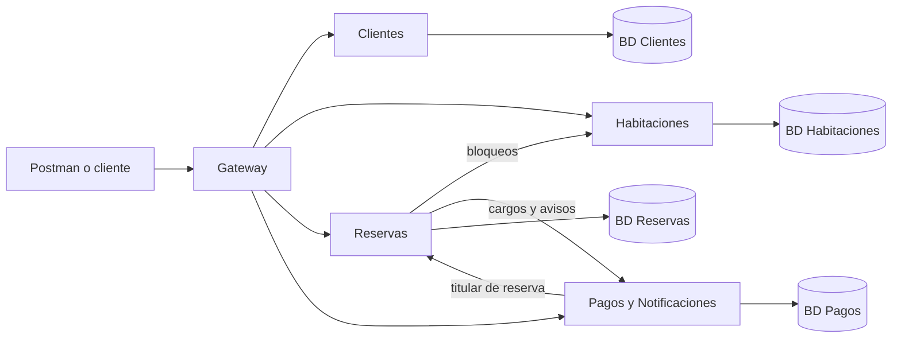
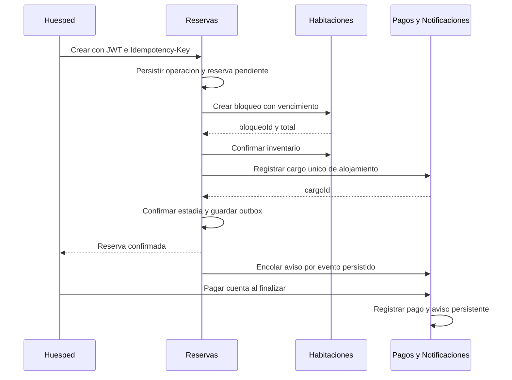

# Arquitectura SOA del Hotel Resort

## Componentes implementados y límites

El monorepositorio contiene cuatro servicios de negocio independientes, un Gateway Nginx y utilidades compartidas de transporte y seguridad. Cada dominio tiene un proceso, una base PostgreSQL, una cuenta propietaria para migraciones y un rol de aplicación para sus datos. No hay consultas SQL ni claves foráneas entre bases.

El diagrama expresa las conexiones del código y de Compose; su validación en ejecución exige una prueba identificable. El Gateway no cuenta como servicio de negocio ni decide disponibilidad o saldos. Sus rutas públicas no exponen `/api/v1/interno`.

| Servicio             | Datos propios                  | Responsabilidad                                                          |
| -------------------- | ------------------------------ | ------------------------------------------------------------------------ |
| Clientes             | Huéspedes y credenciales       | Registro, JWT RS256, perfil propio y JWKS                                |
| Habitaciones         | Catálogo, tarifas y bloqueos   | Disponibilidad, exclusión de rangos solapados, confirmación y liberación |
| Reservas             | Estadías, operaciones y outbox | Propiedad, ciclo de vida, coordinación e intentos recuperables           |
| Pagos/Notificaciones | Cargos, pagos y avisos         | Cuenta, cobro simulado, deduplicación y entrega de avisos                |

## Contratos y seguridad

REST/JSON, `/api/v1`, UUID, ISO 8601 y errores `{codigo,mensaje,detalle,traceId}`. El dinero viaja como cadenas decimales y usa PEN. Clientes firma JWT RS256; Reservas y Pagos reciben únicamente la clave pública y validan emisor, audiencia, expiración y propietario. No aceptan que un `huespedId` enviado por el usuario sustituya su identidad autenticada.

Las llamadas internas usan un Bearer de servicio compartido, distinto del JWT de huésped. Se conserva `traceId` entre saltos sin imprimir tokens. Cada API tiene un usuario SQL sin privilegios de propietario; el script de migraciones conserva los privilegios DDL fuera del proceso que atiende peticiones.

Las operaciones mutables requieren idempotencia según su contrato. Una misma clave y contenido reproduce la operación; contenido diferente produce 409. El precio se obtiene de Habitaciones y no del cliente. No se mantiene una transacción SQL abierta mientras se espera HTTP de otro servicio.

## Política elegida para la demo

La reserva se confirma con un cargo de alojamiento pendiente. El huésped paga al finalizar la estadía mediante `SIMULADO`, con `tok_aprobado` o `tok_rechazado`. El rechazo conserva el saldo. La aprobación registra un pago y un aviso persistente; repetir la misma clave no realiza otro cobro.

Cancelar una reserva sin pago anula su cargo y libera inventario conservando historial. Si existe un pago aprobado, la cancelación automática responde 409. Un reembolso requiere un flujo posterior explícito; no se simula que dinero ya cobrado se devuelve solo por liberar una habitación.

Esta es una concreción académica de la alternativa del informe que decía cobrar “cuando corresponda”. El flujo de anticipo/autorización y reverso de una pasarela real no está implementado. Pagos exige habilitación explícita de los simuladores y rechaza `NODE_ENV=production`.

## Coordinación y recuperación

Habitaciones protege rangos `[desde,hasta)` con restricciones de PostgreSQL. Los bloqueos expiran y se liberan transaccionalmente; consultar primero y escribir después sin protección no sería suficiente. El estado operativo se conserva por separado como `EN_SERVICIO`, `LIMPIEZA` o `MANTENIMIENTO`; la disponibilidad solo incluye habitaciones en servicio. Su cambio usa un endpoint interno autorizado y rechaza retirar inventario ya comprometido.

Reservas conserva operaciones y fases para reintentar dependencias tras reinicio. Si la coordinación aún no concluye puede responder 202 con `reservaId` y `operacionId`; el cliente consulta su reserva o reintenta con la misma clave. Ante un timeout no se asume que la llamada no ocurrió: los contratos internos permiten deduplicar y recuperar. Un estado que necesita intervención no se presenta como reserva completada.

La publicación del aviso se guarda en outbox junto al cambio de estado; su fallo no revierte una estadía confirmada. Pagos conserva avisos e intentos; el worker simulado puede reintentarlos después de reiniciar. No se utiliza un broker externo ni se promete entrega exactamente una vez al proveedor real.

## Despliegue y ampliaciones

Compose ejecuta cuatro PostgreSQL, migraciones, APIs y Gateway. Cada base se conecta únicamente a la red de su dominio; las APIs comparten una red para HTTP interno. Los puertos de prueba se publican exclusivamente en loopback. Las aplicaciones corren como `node` con filesystem de solo lectura y sin privilegios nuevos; el Gateway usa usuario sin privilegios.

La demo local usa HTTP. Un entorno externo necesita TLS en el borde, certificados válidos, gestión y rotación de secretos, restricciones de red, backups y observabilidad. Docker Compose no proporciona por sí mismo alta disponibilidad. Detrás del Gateway el limitador en memoria de Clientes comparte la IP del proxy; no representa limitación distribuida por usuario real.

Restaurante y Spa/Actividades siguen como extensiones del diseño objetivo. Serán dueños de sus consumos y remitirán cargos por `(origen,origenId)` sin editar tablas financieras. El portal web, empleados, check-in/check-out administrativo y reportes tampoco forman parte de esta implementación.
